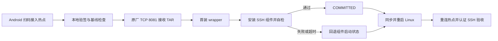

# 703T 仪表 OTA / SSH

复用仪表原有 Wi-Fi + TCP OTA 接收器，安装独立 SSH 组件，用于所有者运行自制软件。包含 Android OTA 工具、增量打包器、安装后自检、失败回退和测试脚本。

**SSH 链路已完成 GT 实机验证。** 已验证的是 NATIVE 0.1.3 原厂 OTA 首装，以及随后通过 SSH 安装的组件 0.1.4；不是所有硬件或任意新构建包均已验收。详见 [实机验证记录](docs/实机验证记录.md)。

## 已有功能

- Android 10+：相机/相册识别标准 Wi-Fi 二维码及原厂 Carbit 投屏链接，接入仪表热点，查询版本，选择并验证本地 TAR，传输全量或文件增量包。
- 自制包 RSA-SHA256 验签、文件清单与 SHA-256 校验、精确基线校验；已知原厂全量包只接受固定哈希。
- AArch64 静态 Dropbear，绑定仪表热点 `192.168.3.1:22`，支持公钥与系统密码认证。
- SSH 组件安装事务、60 秒自检时限、失败回退、自启动、每台设备独立主机密钥。
- 首装 wrapper 安装结束后同步并重启 Linux，避免返回原厂安装器的 MCU 后续流程；重启失败则保持等待。

这里的「增量」是只包含改动文件的小 TAR，**不是分区块差分**。全量包支持传输与验包，不具备通用整机回退。接收进度 100%、TCP 结束或 SSH banner 都不能单独证明安装成功。

## 阅读顺序

1. [实机验证记录](docs/实机验证记录.md)：型号、GT/HW 分支、版本对应及已测/未测范围。
2. [构建与使用](docs/构建与使用.md)：生成自己的密钥、构建 APK/组件/首装包、SSH 验收。
3. [OTA 协议与安装事务](docs/OTA协议与安装事务.md)：线协议、签名作用、提交和回退边界。
4. [测试说明](docs/测试说明.md)：主机离线回归及隔离 ARM64 测试。

## 发布范围

本仓库发布源码和测试，不附带个人密钥、默认密码、个人刷机包、原厂固件、抓包或原始设备日志。构建器会生成使用者自己的身份；APK 的发布公钥在构建时嵌入，不需手动导入手机。请保留本地生成的私钥，以便后续更新使用同一身份。

雷达和 CarPlay 作为独立补丁开发，本次未发布，SSH 包不包含它们。此项目是独立适配项目，不是厂商官方固件。

自有源码使用 [MIT](LICENSE)，依赖见 [第三方说明](THIRD_PARTY_NOTICES.md)。
