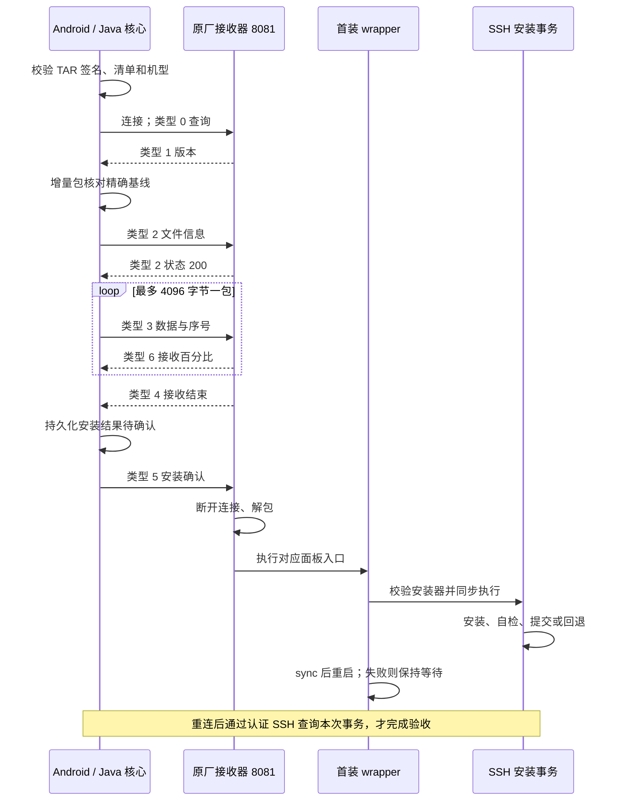

# OTA 协议与安装事务

范围：`JC_703T25_V02.26.02.02.60` 对应 Launcher 的模式 0 OTA 路径。来源是原厂二进制静态核对、[生产 Java 客户端](../android/src/cn/local/instrument703t/core/NativeOtaClient.java) 和 [实机链路验收](实机验证记录.md)，不是完整官方 App 的抓包协议。原厂二进制和反编译全文不在仓库分发。

## 网络与接收

仪表热点接口 `wlan0` 通常为 `192.168.3.1/24`，OTA 监听 `192.168.3.1:8081`。Android 使用所选 Wi-Fi 的 socket，避免蜂窝回退。原厂接收器在建立连接后会停止 DVR 和部分投屏进程，所以连接/查询本身也有副作用。

这里无需先登录 Telnet。没有根据 OTA 接收器的存在推断 Telnet 可用，也没有使用监听 TCP 执行任意 `sh` 的服务。

通用帧：`长度 u16 BE | 类型 u8 | payload | 4A 43`。长度包含类型和 payload，不含长度字段及末尾 ASCII `JC`。按长度读取，不能按 `JC` 搜索分隔，因为信息和数据中也可能出现它。

| 类型 | 方向 | 内容 |
| --- | --- | --- |
| 0 | 手机→仪表 | 查询版本：`00 01 00 4A 43` |
| 1 | 仪表→手机 | 71 字节信息帧：`00 43 01 4A 43` 开始，body 共 67 字节；匹配 `JC_703T25_V` 加五段版本数字，末尾 `JC` |
| 2 | 手机→仪表 | 4 字节文件长度、2 字节文件名长度、32 字节补零文件名；帧头 `00 27 02` |
| 2 | 仪表→手机 | 接受 `00 03 02 00 C8 4A 43`；拒绝 `00 03 02 01 F4 4A 43`。200/500 是二进制状态值，不是 HTTP |
| 3 | 手机→仪表 | 1 字节末包标志（最后一包为 1）、3 字节从 0 开始的包号、最多 4096 字节数据。完整分包头 `10 05 03`；偏移为包号×4096 |
| 6 | 仪表→手机 | 1 字节接收百分比，0–100，不等于安装完成 |
| 4 | 仪表→手机 | `00 01 04 4A 43`，接收结束 |
| 5 | 手机→仪表 | `00 01 05 4A 43`，最后安装确认 |

多字节字段均为大端。接收器检查文件名的机型前缀 `JC_703T25`，客户端为 TAR 生成符合长度限制的线上文件名。不要把本地长文件名直接塞入固定字段。

客户端并发读取进度，在适度发送窗口内传输，每包间隔 2 ms。主路径没有每包 ACK 契约，也没有实现可靠断点续传或自动重发。类型 3 的兼容状态响应仅按当前 Java 实现检查；不能因此推断接收器保证每块确认。

发送安装确认前持久化“已请求安装/结果未确认”。随后等待接收方结束会话，避免手机抢先断开导致接收器状态被重置。等待关闭设有上限；超时和 TCP 结束都不能判定安装成功或自动重试。

## TAR 与签名

自制包包含 `ota703t/manifest.json` 及 `ota703t/manifest.sig`，schema 为 `703t-native-ota-v1`。签名覆盖 manifest 原始字节，算法 RSA PKCS#1 v1.5 + SHA-256；`key_id` 是发布公钥 DER 的 SHA-256。

manifest 字段：`schema`、`model`、`kind`（full/incremental）、`release`、`base_version`、`key_id`、`files`、`test_script`、`rollback_script`。每个文件记录 path、size、mode、sha256。增量要求精确基线、不同且可执行的自检/回退脚本，以及 GT/HW 两个入口。

验包拒绝目录穿越、重复文件、未列出文件、链接、特殊文件、扩展头、错误型号/基线、签名篡改和载荷变化。完整规则以 [NativePackage](../android/src/cn/local/instrument703t/core/NativePackage.java)、[StrictJson](../android/src/cn/local/instrument703t/core/StrictJson.java) 和 [签名器](../tools/native_ota.py) 为准。

公钥用于 **手机端验证发布来源和载荷完整性**，不是 Wi-Fi 密码，也不是 SSH 登录身份。原厂 TCP 通道没有 TLS，原厂安装器不验证此发布签名；客户端验签没有把原厂接收器变成强制验签的安全启动系统。SSH 安装器另外校验自己的 payload 清单，但不替代整个原厂接收端的信任根。

已知原厂全量包通过整包固定 SHA-256 放行；其他自制全量包需要同一发布密钥签名。把 test/rollback 路径写进 manifest 不会自动让原厂运行它们，必须由包内真实安装事务调用。

## 首装入口与组件事务

原厂安装器先清理暂存目录并解 TAR，按固定路径复制可能存在的载荷，再根据 `/proc/lcdv` 执行屏型脚本。脚本返回后原厂父流程还可能进入 MCU/语言更新和心跳操作。因此 SSH 首装包不携带那些业务/底层载荷，且使用统一的 [ota-bootstrap.sh](../tools/ssh703t/ota-bootstrap.sh)：

1. 固定 PATH、umask，检查并移除本包自己的三个重放入口。
2. 用构建时写入的 SHA-256 核对 `ssh703t/install.sh`。
3. 同步等待安装器完成健康检查和提交，或失败回退。
4. `sync` 后重启 Linux；若重启返回或异常退出，保持等待，不返回原厂父流程。

组件安装器先检查 root、架构、面板、Launcher/rcS 哈希、命令与 PTY、可信目录、载荷清单、版本计数器和互斥锁。随后复制新版本至暂存目录，校验并 rename 到不可变 release 目录，备份本组件旧入口和状态，写 PENDING，启动服务并执行有超时的自检。

健康控制器在 60 秒内等待包内检查；通过后提交 component-state 和 COMMITTED，移除 pending。失败或超时恢复旧启动入口/状态并记录回退结果，必要时标记失败；自启动入口可恢复遗留 pending 检查。这些是组件级事务保障，尚不构成已验证的所有断电时刻原子恢复承诺。

自检包含原业务文件基线未变、组件载荷校验、守护进程/监听和主机身份等。真正远端认证和自制脚本执行仍须安装后的独立验收。回退保留 hostkeys 和旧 release，不恢复系统密码、任意应用文件或底层分区。
